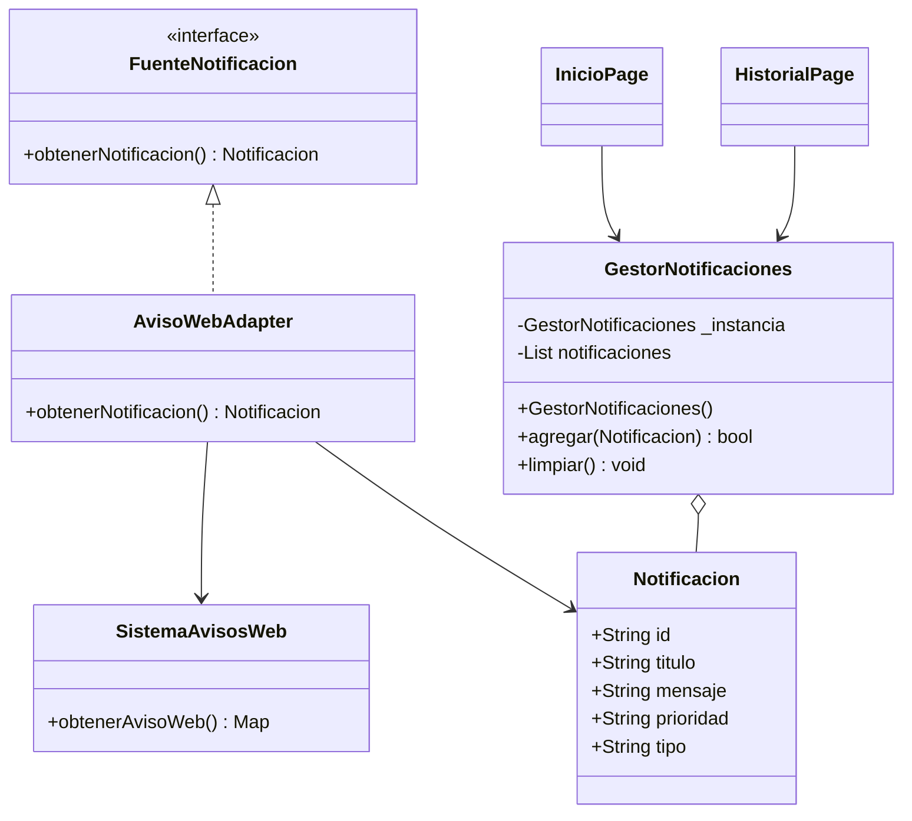

# UniAvisos: Notificaciones universitarias (Flutter)

Prototipo para la tarea **Aplicación de patrones de diseño en Flutter** de Desarrollo Móvil Integral. Implementa **Singleton** y **Adapter** con el estilo de los ejercicios del repositorio `patrones`: una clase por archivo, interfaz abstracta y `main.dart` sencillo.

## Arrancar el proyecto desde cero

Necesitas **Flutter y Android Studio o un dispositivo Android** configurados. Como el código fuente se entrega sin los directorios de plataforma generados automáticamente, hazlo una sola vez:

```bash
cd notificaciones_universitarias
flutter create --platforms=android .
flutter pub get
flutter run
```

En VS Code puedes abrir la carpeta `notificaciones_universitarias` y seleccionar el emulador desde la barra inferior. **No necesitas Firebase, servidor, ni conexión a internet.**

> Nota: `flutter create` añade los archivos estándar de Android que dependen de la instalación local de Flutter. No utilices `--overwrite`, para conservar `lib/` y las pruebas incluidas.

## Estructura

```text
notificaciones_universitarias/
├── lib/
│   ├── main.dart
│   ├── app.dart
│   ├── modelos/
│   │   └── notificacion.dart
│   ├── singleton/
│   │   └── gestor_notificaciones.dart
│   ├── adapter/
│   │   ├── fuente_notificacion.dart
│   │   ├── sistema_avisos_web.dart
│   │   └── aviso_web_adapter.dart
│   ├── pantallas/
│   │   ├── inicio_page.dart
│   │   └── historial_page.dart
│   └── widgets/
│       └── tarjeta_notificacion.dart
├── test/
│   ├── patrones_test.dart
│   ├── pantallas_test.dart
│   └── widget_test.dart
└── pubspec.yaml
```

## 1. Patrones elegidos y justificación

**Singleton:** `GestorNotificaciones` tiene constructor privado `GestorNotificaciones._()`, instancia estática `_instancia` y un constructor `factory` que devuelve la misma referencia. Las pantallas de Inicio e Historial comparten el registro. El método `agregar()` compara el identificador `id` para evitar que un acontecimiento se guarde dos veces. Extiende `ChangeNotifier` para refrescar la interfaz cuando cambia la lista; este mecanismo de Flutter no reemplaza al patrón Singleton.

**Adapter:** `AvisoWebAdapter` implementa la interfaz `FuenteNotificacion` y delega la lectura a `SistemaAvisosWeb`, que devuelve un mapa con los campos propios del sistema externo (`asunto`, `contenido`, `nivel`). El adaptador devuelve una instancia de `Notificacion` con los campos (`titulo`, `mensaje`, `prioridad`), sin obligar a cambiar el sistema externo ni las pantallas. También admite `tituloAviso` como alternativa a `asunto`.

No implementamos Factory Method porque la consigna pide **al menos dos patrones**, y con Singleton y Adapter resolvemos los problemas **1 y 3**. El sistema puede representar tareas, exámenes y avisos con un único modelo.

## 2. UML simplificado



## 3. Demostración en la aplicación

1. En **Inicio**, toca **Registrar una tarea**. El gestor central almacena una notificación.
2. Toca **Registrar un examen**. Aparece otra notificación con prioridad alta.
3. Toca **Importar aviso web (Adapter)**. Se transforma el mapa del ejemplo `asunto/contenido/nivel` y se muestra **Suspensión de clases / Mañana no habrá clases / alta**.
4. Abre el botón de **Historial** (ícono de reloj). Verás los mismos avisos, porque ambas pantallas llaman a `GestorNotificaciones()`.
5. Vuelve a Inicio y pulsa nuevamente cualquier botón. Se informa que ese acontecimiento ya está registrado y no se duplica.

## 4. Pruebas

Ejecuta:

```bash
flutter test
```

El código contiene siete pruebas automatizadas para comprobar:

- Que dos construcciones de `GestorNotificaciones()` devuelven **la misma instancia**.
- Que dos variables que simulan pantallas consultan **el mismo registro**.
- Que el registro **no acepta IDs repetidos**.
- Que el Adapter traduce **asunto, contenido, nivel** a **titulo, mensaje, prioridad**.
- Que el Adapter acepta el campo alternativo **tituloAviso**.
- Que un aviso adaptado desde la interfaz se conserva al abrir el **Historial**.
- Que la aplicación abre correctamente la **pantalla de inicio**.

## 5. Dificultades sin patrones de diseño

Sin **Singleton**, las pantallas podrían construir gestores diferentes, generar notificaciones duplicadas y mostrar historiales distintos. Sin **Adapter**, la interfaz móvil dependería directamente de claves del JSON externo y un cambio en el sistema web obligaría a modificar varias pantallas o clases.

## 6. Respuestas a las preguntas de la tarea

**¿Qué pasaría si cada pantalla tuviera un gestor?** Cada pantalla podría manejar una lista diferente y perder el registro compartido, además de permitir duplicados.

**¿Qué sucede si agregan avisos de becas?** Nuestro modelo ya acepta otros valores de `tipo`, por ejemplo `Beca`; agregaríamos el botón o mecanismo que origine el nuevo acontecimiento, pero no tendríamos que modificar `GestorNotificaciones` ni `AvisoWebAdapter`, a menos que el formato externo también cambiara. Esta solución no incluye una Factory Method para seleccionar automáticamente múltiples clases concretas.

**¿Qué sucede si el sistema web cambia `asunto` por `tituloAviso`?** Solo corresponde actualizar `AvisoWebAdapter`. En este prototipo ya acepta ambos campos.

**¿Por qué sería mala idea usar Singleton para todo?** Generaría dependencias globales innecesarias, dificultaría las pruebas, haría más difícil mantener estados independientes y acoplaría las clases. Lo utilizamos solo para el gestor que necesita ser compartido.

## Relación con los ejemplos de `patrones`

| Ejemplo anterior | Este ejercicio |
| --- | --- |
| `Configuracion` (Singleton) | `GestorNotificaciones` |
| `MedioPago` / `Impresora` | `FuenteNotificacion` |
| `TerminalExterna` / `ImpresoraAntigua` | `SistemaAvisosWeb` |
| `TerminalAdapter` / `ImpresoraAdapter` | `AvisoWebAdapter` |
| `Tienda` / `Oficina` | `InicioPage` |

**Alcance:** datos simulados en memoria. Al cerrar por completo la aplicación se reinicia la lista. La deduplicación se hace por `id`: dos eventos distintos necesitan IDs distintos.
